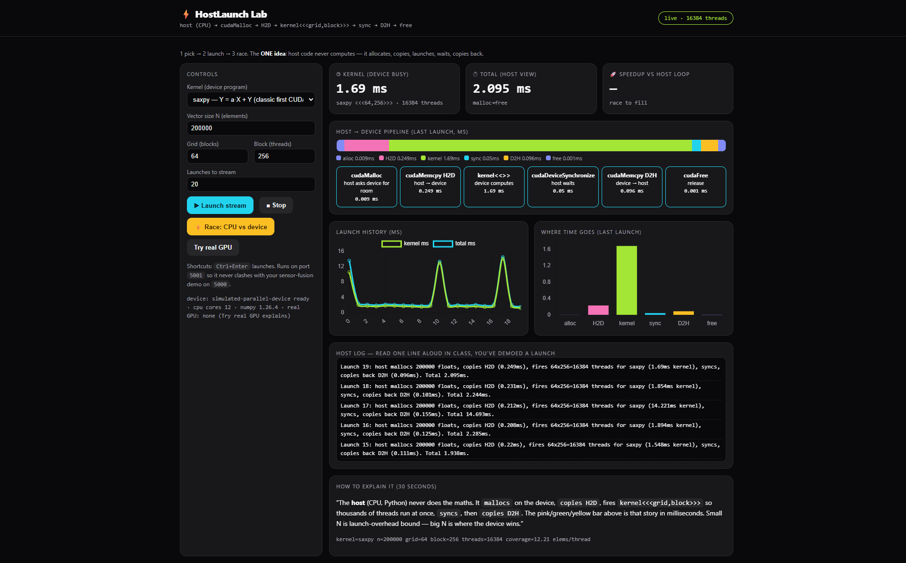
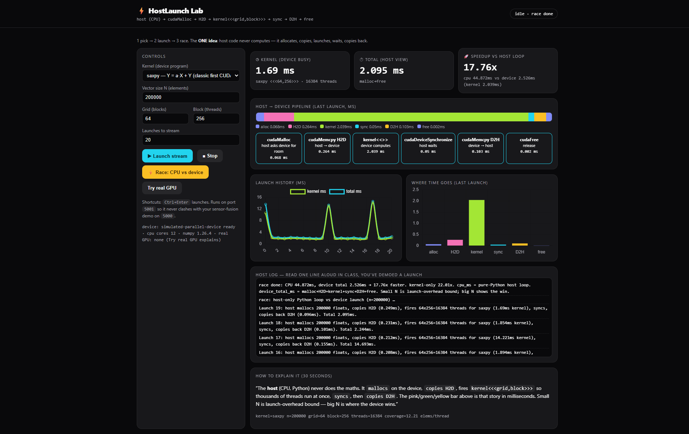
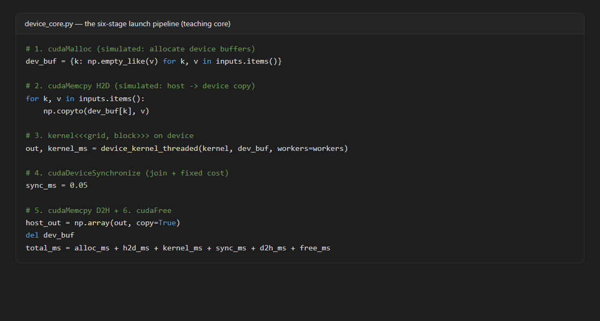
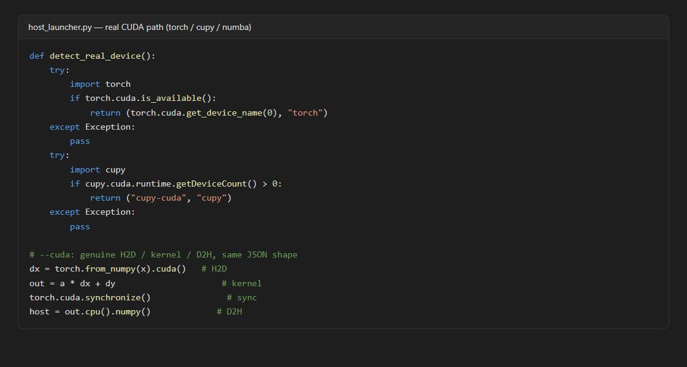

# HostLaunch Lab — how host code launches device computation

A realtime visualiser for the **CUDA kernel execution model**: watch a host (CPU) program allocate device memory, copy data in, launch a kernel with an explicit `grid × block` configuration, synchronise, and copy results back — timed per stage, streamed live to the browser.



## Quickstart (no GPU needed, port 5001)

```powershell
cd host-device-launch-lab
python -m pip install flask numpy
python app.py
# open http://127.0.0.1:5001
```

- **Launch stream** — live `H2D → kernel → D2H` pipeline with per-stage timings and charts
- **Race: CPU vs device** — pure-Python host loop vs the device launch path, with speedup
- **Try real GPU** — probes torch / cupy / numba CUDA, otherwise explains the fallback

Headless (no browser):

```powershell
python host_launcher.py --n 50000 --launches 5 --delay 0
python host_launcher.py --check-device
```

## How it works

Every launch goes through the same six stages, mirroring the CUDA runtime API:

| Stage | CUDA analogue | What happens |
|---|---|---|
| alloc | `cudaMalloc` | Device buffers reserved for the vectors |
| H2D | `cudaMemcpy` (host → device) | Inputs copied across the interconnect |
| kernel | `kernel<<<grid, block>>>` | `grid × block` threads compute (saxpy / vecadd / blur) |
| sync | `cudaDeviceSynchronize` | Host waits until all threads finish |
| D2H | `cudaMemcpy` (device → host) | Output vector copied back |
| free | `cudaFree` | Device buffers released |



The device is simulated with a thread pool (standing in for GPU multiprocessors), so the full pipeline runs anywhere. On a CUDA machine, `python host_launcher.py --cuda` executes the same launches on a real GPU and reports identical JSON, rendered by the same dashboard:

```powershell
python host_launcher.py --cuda --n 200000 --launches 5
```

Measured on a Ryzen 5 5600H (200k-element saxpy, 64 blocks × 256 threads): ~44.9 ms host loop vs ~2.5 ms device launch (**~17.8x speedup**, kernel-bound with transfers under 20%).

## The launch pipeline in code





## Benchmark

```powershell
python -c "from device_core import run_cpu_vs_device; b=run_cpu_vs_device(n=200000); print(b)"
```

Small vectors are launch-overhead bound (copies dominate); large vectors show the device win — that crossover is the expected discussion point.

## Files

- `device_core.py` — kernels (saxpy / vecadd / blur) + full launch pipeline with per-stage timings
- `host_launcher.py` — host CLI: simulated by default, `--cuda` for torch / cupy / numba, `--check-device` probe
- `app.py` — Flask + SSE `/stream`, `/api/benchmark`, `/api/device-status`, `/api/cuda-run` (port 5001)
- `templates/index.html` — live dashboard: pipeline bar, history charts, host log
- `report/` — seminar report (CUDA kernel execution model)
- `report_shots/` — dashboard and code screenshots used in the report
- `build_report.py` — regenerates the report docx from live code + fresh screenshots
- `wsl-setup.sh` — real-CUDA setup for a GPU / WSL machine
